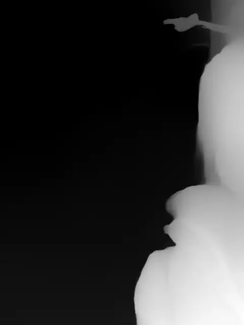

# Case 014 · Qinglin Depth-Map Extraction

`Standalone` · `edit-timeline-studio` · Built with [Timeline Studio](https://github.com/MartinDelophy/ai-video-editor) · [简体中文](README.zh-CN.md)

## 1. One-line prompt

> Convert this 14-second video into a per-frame grayscale depth-map video with Timeline Studio's depth-extraction capability.

## 2. Result

[Watch the result video](assets/result.mp4) · [Download the editable `.timeline` project](assets/qinglin-depth-map.timeline)

Timeline Studio used Depth Anything V2 Small to estimate relative scene depth for every source frame. The result is a silent 14-second, 720×960, 30 fps H.264 video with 420 frames: nearer regions appear brighter and farther regions darker. The published MP4 passes a complete decode check, and the portable `.timeline` contains that exact result as one editable visual clip.

The original third-party source is not redistributed because no authorized remote copy was available. This case therefore uses the standalone format rather than presenting an unverifiable comparison.

Session: `01a104ed-d3a8-7751-ae80-6b70670968d6`
