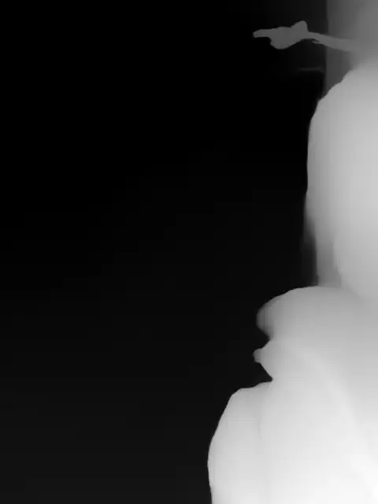

# Case 014 · 青鳞深度图提取

`生成型` · `edit-timeline-studio` · 使用 [Timeline Studio](https://github.com/MartinDelophy/ai-video-editor) 制作 · [English](README.md)

## 1. 一句话提示词

> 使用 Timeline Studio 的深度提取能力，把这段 14 秒视频逐帧转换成灰度深度图视频。

## 2. 结果视频

[观看结果视频](assets/result.mp4) · [下载可编辑 `.timeline` 工程](assets/qinglin-depth-map.timeline)

Timeline Studio 使用 Depth Anything V2 Small 对源视频的每一帧进行相对场景深度估计。结果是一条无声的 14 秒、720×960、30 fps H.264 视频，共 420 帧：近处更亮，远处更暗。发布的 MP4 已通过完整解码检查，便携 `.timeline` 工程则把同一条结果视频作为一条可编辑画面轨道内嵌保存。

由于没有可确认授权的原视频远端副本，本案例不重新分发第三方原素材，也不伪造对比，因此采用单结果展示。

Session：`01a104ed-d3a8-7751-ae80-6b70670968d6`
